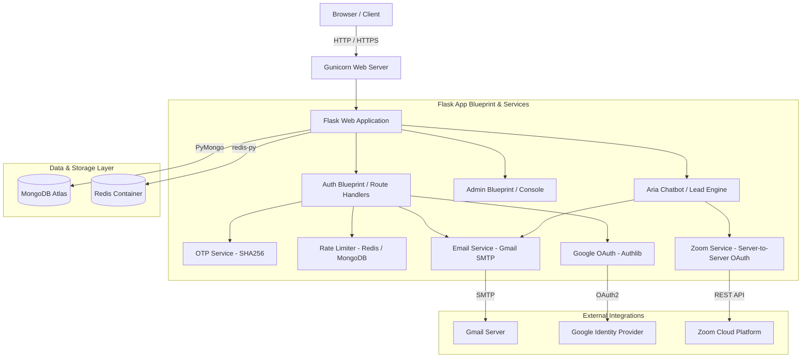
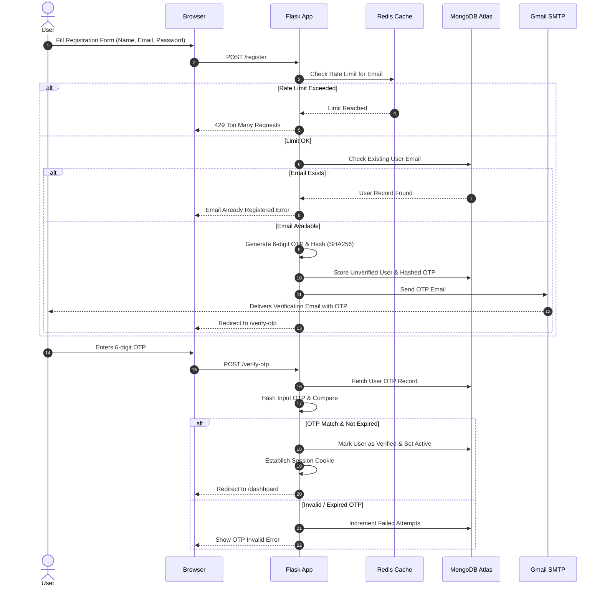
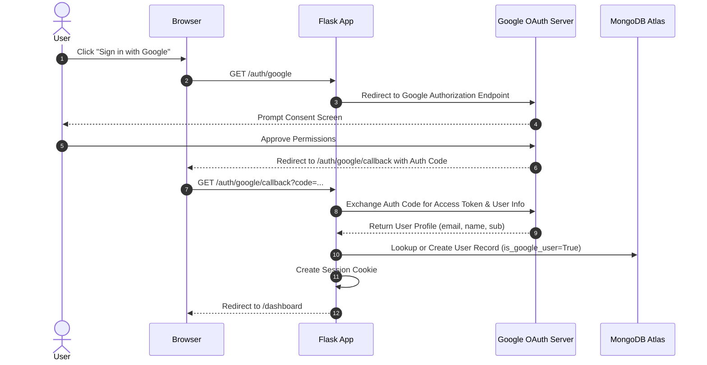
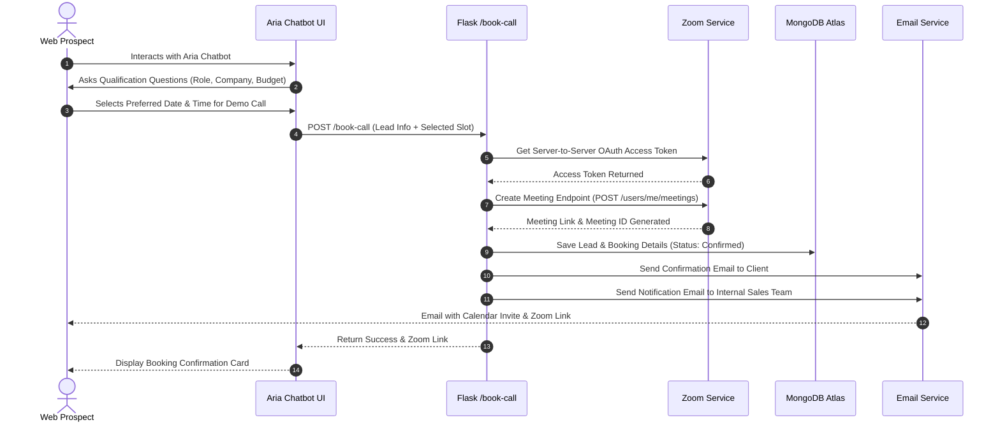
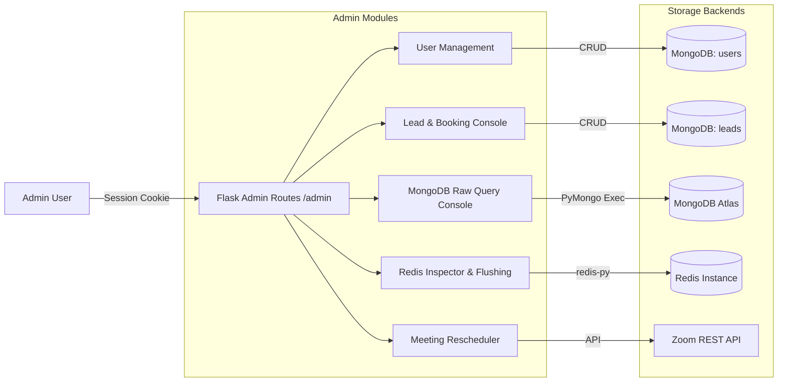
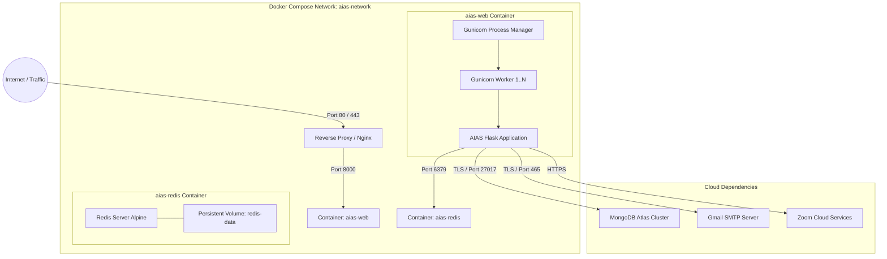

# AIAS System Architecture & Flow Diagrams

This document contains Mermaid diagrams illustrating the system architecture, authentication flows, chatbot lead qualification, Zoom integration, and Docker deployment topology for the AIAS platform.

---

## 1. High-Level System Architecture

---

## 2. User Registration & OTP Verification Flow

---

## 3. Google OAuth 2.0 Sign-In Flow

---

## 4. Aria Chatbot Lead Qualification & Zoom Meeting Booking

---

## 5. Admin Dashboard & Operations Architecture

---

## 6. Docker Deployment & Container Topology

